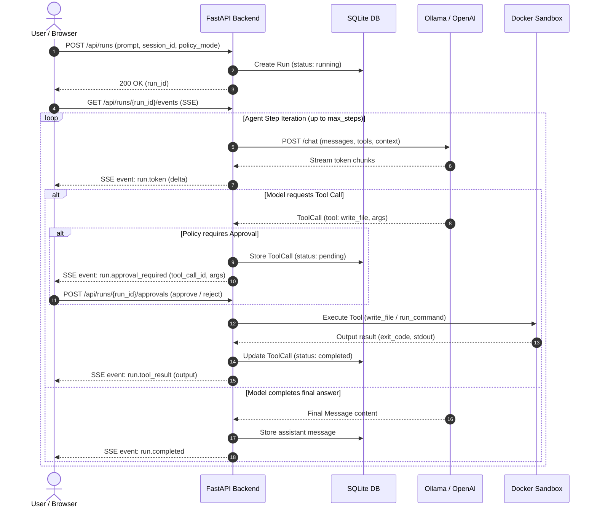

# Communication Protocols & Event Streaming

This document details how the Web UI, FastAPI backend, LLM providers, and background workers communicate.

---

## 1. Communication Matrix

| Source | Destination | Transport | Auth | Default Endpoint | Notes |
|---|---|---|---|---|---|
| **Web UI** | FastAPI API | HTTP REST | Cookie `chege_token` / Bearer | `http://127.0.0.1:9100/api` | JSON request/response models |
| **Web UI** | FastAPI SSE | HTTP EventSource | Cookie or `?token=<token>` | `http://127.0.0.1:9100/api/runs/{id}/events` | Real-time token streaming and step events |
| **FastAPI** | Ollama | HTTP REST | None (Internal network) | `http://host.docker.internal:11434` | Chat completions with tool calling |
| **FastAPI** | OpenAI | HTTPS REST | `Authorization: Bearer <key>` | `https://api.openai.com/v1` | OpenAI API compatible completion endpoint |
| **FastAPI** | Docker Proxy | HTTP REST | None (Private network) | `tcp://docker-socket-proxy:2375` | Container lifecycle and exec API |

---

## 2. Agent Execution Loop & SSE Sequence



---

## 3. Real-Time Server-Sent Events (SSE) Contract

Endpoint: `GET /api/runs/{run_id}/events`

Clients connect using standard `EventSource`. Query parameter `?after=<seq>` enables catchup of missed events after reconnecting.

### Event Format:
```text
id: 42
event: run.step
data: {"step": 3, "status": "calling_tool", "tool": "read_file"}

id: 43
event: run.token
data: {"token": "Refactoring"}

id: 44
event: run.tool_result
data: {"tool": "read_file", "output": "1: def hello():\n2:   pass"}

id: 45
event: run.completed
data: {"run_id": "9b1deb4d-3b7d-4bad-9bdd-2b0d7b3dcb6d", "duration_ms": 1420}
```

### Event Types:
- `run.step`: Iteration index and state change.
- `run.token`: Incremental LLM completion tokens.
- `run.approval_required`: Emitted when an execution requires user confirmation.
- `run.tool_result`: Stdout, stderr, and return status from executed tools.
- `run.completed`: Successfully terminated run.
- `run.failed`: Error details upon failure or unrecoverable exception.
- `run.cancelled`: Emitted when an operator explicitly aborts a run.
