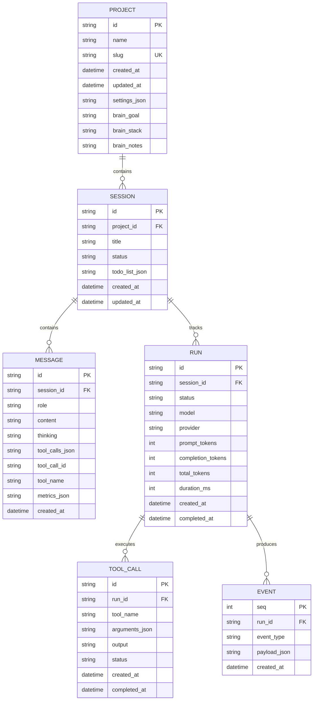

# Data & Storage Architecture

Chege Agent maintains persistent state across project workspaces, conversation sessions, individual agent runs, and historical execution checkpoints.

---

## 1. Database Schema (SQLModel)

By default persistent relational data is stored in embedded SQLite at `./data/chege.db`. Setting `CHEGE_DATABASE_URL` switches the same SQLModel schema to Postgres; `bash scripts/deploy.sh --with-postgres` starts an internal Postgres container and sets the DSN automatically. The password-bearing DSN is masked in `/api/v1/settings` and on the status page. SQLite-only PRAGMAs (WAL, foreign keys, synchronous NORMAL) are applied only to SQLite engines; Postgres uses `pool_pre_ping`.



---

## 2. Storage Directory Layout

```text
/app/
├── data/
│   ├── chege.db          # Main SQLite database (WAL mode enabled)
│   ├── chege.db-shm      # Shared memory file for SQLite WAL
│   └── chege.db-wal      # Write-Ahead Log journal
├── workdir/              # Project workspace roots
│   ├── my-project/       # Each project has its own isolated directory
│   │   ├── .git/         # Auto-initialized Git version control repository
│   │   └── src/          # Generated application code
│   └── another-project/
└── logs/
    └── {project_slug}/
        └── project_brain.json # Project brain memory fallback and step history
```

---

## 3. Project Brain & Memory System

Each project maintains an active memory footprint containing:
- **`brain_goal`**: Overall mission or user specifications.
- **`brain_stack`**: Language, libraries, tools, and framework definitions.
- **`brain_notes`**: Developer instructions, architectural decisions, and constraints.
- **`todo_list`**: Dynamic task list updated automatically as steps complete.

During every agent step, the Project Brain is retrieved and compiled into the LLM system prompt context, ensuring the model never forgets the architectural guidelines or current milestone.
