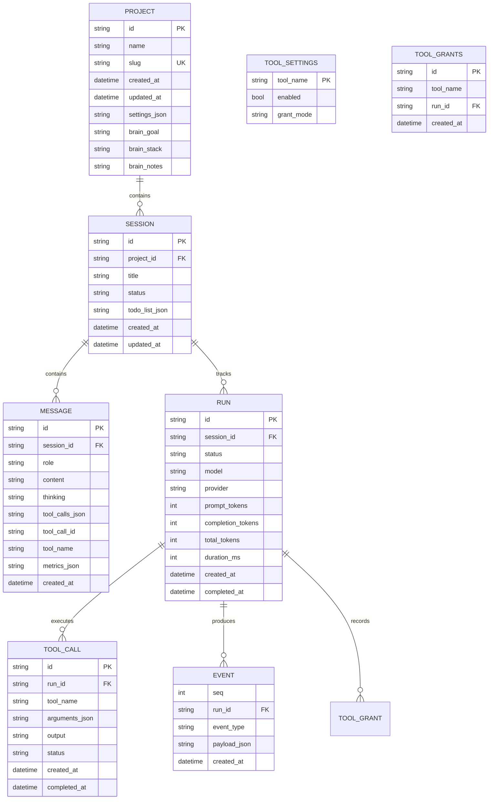

# Data & Storage Architecture

Chege Agent maintains persistent state across project workspaces, conversation sessions, individual agent runs, and historical execution checkpoints. The deployment is single-user and local-only (loopback binding, no authentication, users, or tenants); all REST access is under `/api/v1/*` at `http://127.0.0.1:8001/`.

---

## 1. Database Schema (SQLModel)

Persistent relational data is stored in embedded SQLite at `./data/chege.db` using SQLModel. Deploy only with `bash scripts/deploy.sh --isolated`, which recreates **only** `chege-local-agent` and never touches unrelated containers. SQLite WAL mode is used (see the `-shm` and `-wal` files below). Secrets and password-bearing values are masked in `/api/v1/settings`. Settings can also be persisted as defaults to `data/settings.json` (written atomically with mode `0600`) via `PUT /api/v1/settings/defaults`; `DELETE /api/v1/settings/defaults` clears those saved defaults, while `PATCH /api/v1/settings` changes the running process only.



**Tool governance tables.** `tool_settings` holds the per-tool governance state written by `PATCH /api/v1/tools/{tool_name}`: `enabled` (default `true`) and `grant_mode` (`none` by default, or `prompt_once`). Disabled tools are excluded from the model's tool schemas and blocked again at execution time; `prompt_once` grants are requested once per run, recorded in `tool_grants`, and enforced there. These are checked before the per-run approval policy (`auto_edit` by default; `ask_all` or `full_auto` selectable), so disabled tools and grants hold even in `full_auto`. `ApprovalPolicy` remains **unused** and grants must not be described as using it.

**Event sequencing.** `EVENT.seq` values are sequence numbers derived per run from the database, not client-supplied. The SSE endpoint uses them with `Last-Event-ID` / `?after=` for replay; it subscribes before replaying history and drops already-replayed live events so reconnects and restarts neither lose nor duplicate events. Keep-alive pings are sent every 20 seconds and a terminal event ends the stream. SSE delivers structured, redacted event summaries (including `run.phase`); raw server logs are not exposed.

---

## 2. Storage Directory Layout

```text
/app/
├── data/
│   ├── chege.db          # Main SQLite database (WAL mode enabled)
│   ├── chege.db-shm      # Shared memory file for SQLite WAL
│   ├── chege.db-wal      # Write-Ahead Log journal
│   └── settings.json     # Saved settings defaults (atomic write, mode 0600)
├── workdir/              # Project workspace roots
│   ├── my-project/       # Each project has its own isolated directory
│   │   ├── .git/         # Auto-initialized Git version control repository
│   │   └── src/          # Generated application code
│   └── another-project/
└── logs/
    └── {project_slug}/
        └── project_brain.json # Project brain memory fallback and step history
```

---

## 3. Project Brain & Memory System

Each project maintains an active memory footprint containing:
- **`brain_goal`**: Overall mission or user specifications.
- **`brain_stack`**: Language, libraries, tools, and framework definitions.
- **`brain_notes`**: Developer instructions, architectural decisions, and constraints.
- **`todo_list`**: Dynamic task list updated automatically as steps complete.

During every agent step, the Project Brain is retrieved and compiled into the LLM system prompt context, ensuring the model never forgets the architectural guidelines or current milestone.
