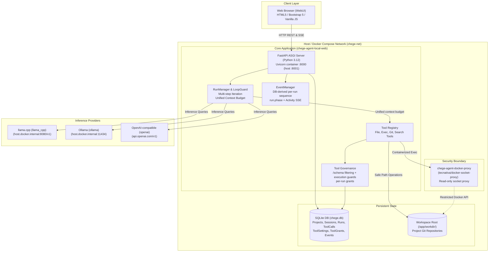

# Architecture Overview

Chege Agent is an autonomous, self-hosted AI pair programmer designed to operate with local or remote LLMs while enforcing strict security boundaries around workspace execution. It is single-user and local-only: the service binds to the loopback interface and has no authentication, users, or tenants. The canonical URL is `http://127.0.0.1:8001/`.

---

## 1. Container & Component Diagram

Only `chege-agent-local-web` is recreated by `bash scripts/deploy.sh --isolated`; the host mapping is 8001 → container 8000. All REST routes are `/api/v1/*` and there is no authentication layer.

---

## 2. Component Directory Map

| Component | Directory | Runtime / Tech | Purpose |
|---|---|---|---|
| **API Routers** | `backend/app/api/` | FastAPI / Pydantic | Exposes `/api/v1/*` REST endpoints for projects, sessions (including fork and todos), runs, files (including the nested `/files/tree` browser), tools, settings, and providers. |
| **Agent Engine** | `backend/app/agent/` | Python 3.12 | Orchestrates prompt assembly, loop guards, step checkpoints, and a unified context budget: `default_context_window` reserves tool-schema tokens and a completion allowance before building history. |
| **Tool Registry** | `backend/app/tools/` | Python 3.12 | Implements atomic file operations, bash command execution, git tracking, and file search; disabled tools are blocked here at execution time. |
| **Tool Governance** | `backend/app/tools/` + `backend/app/db/` | SQLModel / Python | `/tools` page and `GET/PATCH /api/v1/tools*` APIs backed by `tool_settings` and `tool_grants` tables; schema filtering plus mandatory execution guards and per-run `prompt_once` grants. |
| **Sandbox Subsystem** | `backend/app/sandbox/` | Docker API / Subprocess | Enforces process isolation for executing shell commands and user scripts. |
| **Providers** | `backend/app/providers/` | httpx / ollama-python | Normalizes tool schemas and streaming output across `llama_cpp` (llama.cpp), `ollama` (Ollama), and `openai` (OpenAI-compatible) APIs. |
| **Event Bus** | `backend/app/events/` | Python Asyncio | Manages real-time SSE with DB-derived per-run sequence numbers, `Last-Event-ID` replay, keep-alive pings, `run.phase` updates, and the Activity feed. |
| **Database** | `backend/app/db/` | SQLModel / SQLite | Persists relational state (projects, sessions, messages, runs, tool calls, tool settings, tool grants, and events). |
| **Web UI** | `webui/index.html` | Vanilla JS / Bootstrap | Single-page UI with syntax highlighting, diff rendering, the `/tools` governance page, an expandable tree-style Files tab, and phase/Activity indicators in `/app`. |

---

## 3. Trust Boundaries & Security Principles

1. **Host Isolation**: The Chege Agent application container does not mount the host Docker socket directly. Instead, it communicates with `chege-agent-docker-proxy`, which strictly denies network and volume management endpoints.
2. **Path Traversal Defense**: All file tools enforce `_safe_path()` checks against `/app/workdir/{project_slug}`. Symbolic links escaping the workspace root are rejected.
3. **Approval Safety Gates**: Approvals default to `auto_edit`; ordinary writes and exact safe commands are auto-approved while destructive writes are always gated. `ask_all` and `full_auto` are selectable per run (`policy_mode`), but tool governance always applies first: disabled tools block and `prompt_once` grants are required even in `full_auto`. An automatic checkpoint is taken before every run.
4. **Tool Governance**: Disabled tools are absent from the schemas sent to the model and are blocked by a mandatory execution guard, so a text-protocol tool-call injection cannot re-enable them. `grant_mode=prompt_once` requires a recorded, per-run user grant before that tool executes; grants are auditable in `tool_grants`. `ApprovalPolicy` is not used for grants.
5. **Loop Protection**: The `LoopGuard` detector detects identical repetitive tool calls and terminates stalled loops before token exhaustion.
