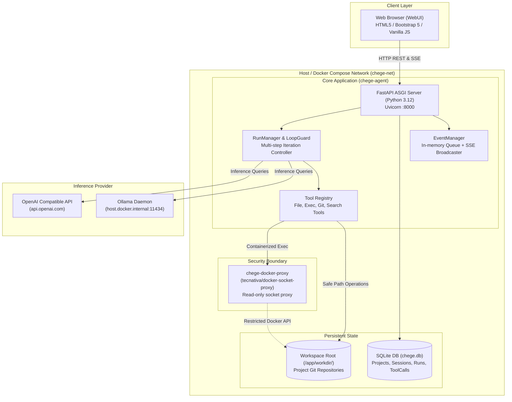

# Architecture Overview

Chege Agent is an autonomous, self-hosted AI pair programmer designed to operate with local or remote LLMs while enforcing strict security boundaries around workspace execution.

---

## 1. Container & Component Diagram

---

## 2. Component Directory Map

| Component | Directory | Runtime / Tech | Purpose |
|---|---|---|---|
| **API Routers** | `backend/app/api/` | FastAPI / Pydantic | Exposes REST endpoints for projects, sessions, runs, files, settings, and providers. |
| **Agent Engine** | `backend/app/agent/` | Python 3.12 | Orchestrates prompt assembly, loop guards, context pruning, and step checkpoints. |
| **Tool Registry** | `backend/app/tools/` | Python 3.12 | Implements atomic file operations, bash command execution, git tracking, and file search. |
| **Sandbox Subsystem** | `backend/app/sandbox/` | Docker API / Subprocess | Enforces process isolation for executing shell commands and user scripts. |
| **Providers** | `backend/app/providers/` | httpx / ollama-python | Normalizes tool schemas and streaming output between Ollama and OpenAI-compatible APIs. |
| **Event Bus** | `backend/app/events/` | Python Asyncio | Manages real-time SSE queues, sequence numbers, and client catchup. |
| **Database** | `backend/app/db/` | SQLModel / SQLite | Persists relational state (projects, sessions, messages, runs, and tool calls). |
| **Web UI** | `webui/index.html` | Vanilla JS / Bootstrap | Single-page UI with syntax highlighting and diff rendering. |

---

## 3. Trust Boundaries & Security Principles

1. **Host Isolation**: The Chege Agent application container does not mount the host Docker socket directly. Instead, it communicates with `chege-docker-proxy`, which strictly denies network and volume management endpoints.
2. **Path Traversal Defense**: All file tools enforce `_safe_path()` checks against `/app/workdir/{project_slug}`. Symbolic links escaping the workspace root are rejected.
3. **Approval Safety Gates**: Any mutating or destructive tool calls (`write_file`, `delete_file`, `run_command`, `git_commit`) are halted for user approval unless the session is explicitly set to `full_auto`.
4. **Loop Protection**: The `LoopGuard` detector detects identical repetitive tool calls and terminates stalled loops before token exhaustion.
